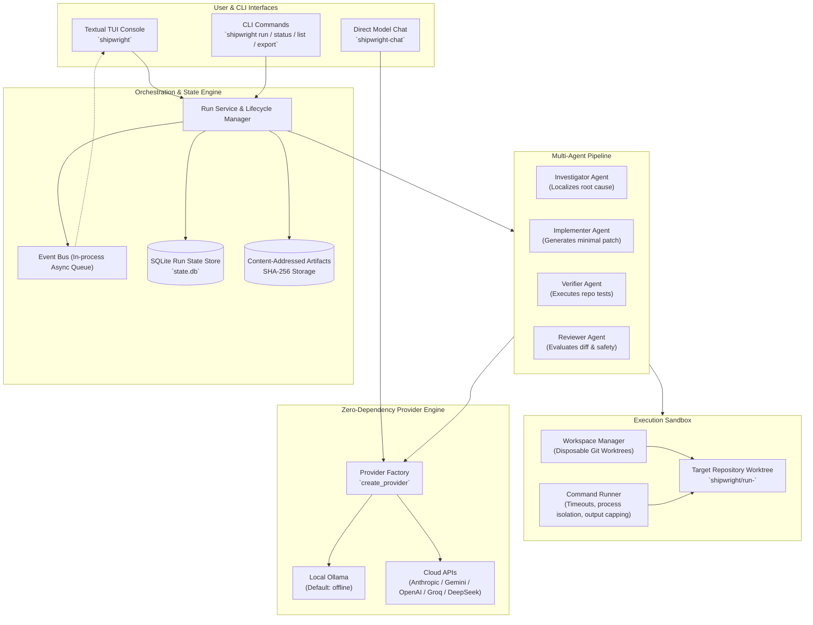

# Shipwright

**Autonomous issue-to-PR engineering, operated from a terminal.**

Shipwright turns a reproducible GitHub issue into a tested, reviewable patch across **any repository** — whether local or remote (GitHub shorthand `owner/repo`, Git URLs, or auto-inferred from issue links) — with out-of-the-box multi-language test detection for Python, Node/TypeScript, Rust, Go, Ruby, Java/Kotlin, and C/C++. It runs a bounded multi-agent coding loop inside an isolated Git worktree and produces a verifiable patch bundle with comprehensive test evidence. Publishing a branch or pull request is strictly guarded by an explicit human approval gate.

```text
GitHub Issue ──> Investigator ──> Implementer ──> Verifier (tests) ──> Reviewer ──> Human Approval ──> PR / Patch
                      │                 │               │ (fails)          │
                      └─────────────────┴───────────────┴─> Repair Loop ───┘
```

---

## Architecture Overview

Shipwright decouples the interactive presentation layer from the underlying execution sandbox and agent engine.



### Core Components
1. **Interactive TUI Operator Console:** Keyboard-first terminal dashboard built with Textual, featuring a live run queue, metric counters (State, Agents, Tests), a real-time event timeline, diff/log viewers, and an explicit approval gate.
2. **Headless CLI Command Suite:** Scriptable subcommands (`shipwright run`, `shipwright status`, `shipwright list`, `shipwright export`) enabling automated execution, pipeline integration, and status querying without the interactive TUI.
3. **Multi-Agent Orchestrator:** Sequential, role-specific agents (`Investigator` → `Implementer` → `Verifier` → `Reviewer`) driven by structured prompts and bounded by a self-correcting repair loop (`REPAIRING`).
4. **Isolated Worktree Sandbox:** Every execution takes place in a disposable Git worktree (`shipwright/run-<id>`) with subprocess sandboxing (restricted cwd, timeouts, capped output, process group cleanup) to safeguard the user's primary repository.
5. **SQLite State & Artifact Persistence:** Lifecycle states (`QUEUED` → `INVESTIGATING` → `PLANNED` → `IMPLEMENTING` → `VERIFYING` → `REVIEWING` → `READY_FOR_APPROVAL` → `EXPORTED`) and timeline events are persisted in SQLite, while diffs, test logs, and bundles are stored as immutable content-addressed artifacts.
6. **Zero-Dependency Provider Engine:** Pure Python standard library HTTP client (`urllib.request`) supporting local Ollama by default alongside cloud providers (Anthropic, Gemini, OpenAI, OpenRouter, Groq, DeepSeek, etc.).
7. **Human Approval Gate:** Code modifications are never pushed to a remote repository or merged automatically; an operator must explicitly approve the export bundle or draft PR.
8. **Universal Repository & Multi-Language Verification:** Run against local directories, remote GitHub repositories (`owner/repo`), arbitrary Git URLs, or auto-inferred issue URLs, with automated test discovery and execution for Python, Node/TypeScript, Rust, Go, Ruby, Java/Kotlin, and C/C++.

---

## Runtime Requirements & Tooling

Shipwright is designed for modern Python environments and reproducible Linux environments:

- **Python Runtime:** **Python 3.14+** (specifically pinned to `3.14.7` in [`.python-version`](.python-version)).
- **Package & Environment Management:** [uv](https://docs.astral.sh/uv/) is the canonical tool for dependency resolution and execution.
- **Git:** Git 2.30+ for worktree management and branch isolation.
- **Optional Local LLM:** [Ollama](https://ollama.com/) for 100% offline, zero-API-key model execution.

---

## Quick Start Guide

### 1. Install `uv` and Python 3.14+
If `uv` is not installed on your system:
```bash
curl -LsSf https://astral.sh/uv/install.sh | sh
```

Clone the repository and install the pinned Python 3.14.7 interpreter:
```bash
git clone https://github.com/VIKSIT-GARG/SHIPWRIGHT.git
cd SHIPWRIGHT

uv python install 3.14.7
```

### 2. Synchronize Dependencies
Install all project dependencies into a locked virtual environment:
```bash
uv sync --locked --all-extras
```

### 3. Run the Test Suite
Verify that all unit tests, provider tests, and UI tests pass:
```bash
uv run --locked pytest -q
```

### 4. Launch the Interactive Operator Console
Launch the Textual TUI operator console:
```bash
uv run --locked shipwright
```
Use `j`/`k` to navigate the run queue, inspect metrics and timeline events, and press `q` to exit.

### 5. Smoke Test a Model Provider
The default provider is local Ollama. Test connectivity and model inference:
```bash
# Verify with local Ollama
SHIPWRIGHT_MODEL=qwen2.5-coder:7b uv run --locked shipwright-chat "Reply with exactly: SHIPWRIGHT_OK"

# Or test with an Anthropic API key
SHIPWRIGHT_PROVIDER=anthropic ANTHROPIC_API_KEY=your-key uv run --locked shipwright-chat "Summarize worktree isolation in one sentence."
```

---

## Universal Repository & Multi-Language Support

Shipwright is designed to operate on **any codebase** across local and remote environments, automatically discovering project structures and running language-specific test suites.

### 1. Target Any Repository

Shipwright supports four flexible repository targeting models:

- **Local Repositories (`--repo /path/to/project`):**
  Work directly against any local Git directory on your filesystem:
  ```bash
  uv run --locked shipwright run 1842 --repo /path/to/project
  ```

- **Remote GitHub Repositories via Shorthand (`--repo owner/repo`):**
  Target public or authenticated private GitHub repositories using `owner/repo` shorthand (e.g. `pallets/flask`):
  ```bash
  uv run --locked shipwright run 5402 --repo pallets/flask
  ```

- **Remote Git URLs (`--repo https://github.com/owner/repo.git`):**
  Target any standard HTTPS or SSH Git clone URL:
  ```bash
  uv run --locked shipwright run 1842 --repo https://github.com/owner/repo.git
  ```

- **Auto-Inferred Repository from Issue URL:**
  Pass a full GitHub issue URL as the issue argument. Shipwright automatically extracts the repository owner and name, clones the upstream target, and loads the issue metadata:
  ```bash
  uv run --locked shipwright run https://github.com/owner/repo/issues/123
  ```

---

### 2. Multi-Language Test Detection & Verification

Shipwright's Verifier Agent dynamically inspects repository manifests and source directories to detect the language toolchain and test framework, running tests inside an isolated sandbox worktree:

| Ecosystem / Language | Detected Files & Frameworks | Default Test Command |
| :--- | :--- | :--- |
| **Python** | pytest, unittest (`pyproject.toml`, `setup.cfg`, `setup.py`, `tests/`) | `pytest -q` or `python -m unittest` |
| **Node.js / TypeScript** | `package.json` (`npm`, `pnpm`, `yarn`, `bun`) | `npm test`, `pnpm test`, `yarn test`, `bun test` |
| **Rust** | `Cargo.toml` | `cargo test` |
| **Go** | `go.mod` | `go test ./...` |
| **Ruby** | `Gemfile`, `Rakefile` (`rake`, `rspec`) | `bundle exec rake test` or `bundle exec rspec` |
| **Java / Kotlin** | `pom.xml` (Maven), `build.gradle` / `build.gradle.kts` (Gradle) | `mvn test`, `./gradlew test`, `gradle test` |
| **C / C++** | `CMakeLists.txt` (`ctest`), `Makefile` (`make`) | `ctest --output-on-failure` or `make test` |

#### Custom Test Command Override (`--test-cmd`)
Override automated test detection at any time with an explicit command string:
```bash
# Rust integration tests
uv run --locked shipwright run 42 --repo owner/rust-crate --test-cmd "cargo test --test integration"

# Node/TypeScript test suite
uv run --locked shipwright run 108 --repo owner/web-app --test-cmd "npm run test:unit"

# Go single-package tests
uv run --locked shipwright run 77 --repo owner/go-service --test-cmd "go test -v ./pkg/auth/..."

# Python targeted test path
uv run --locked shipwright run 1842 --repo /path/to/project --test-cmd "pytest tests/unit/test_auth.py"
```

---

## CLI Command Reference

Shipwright provides a unified command line interface for both interactive operator usage and headless scripting:

```text
shipwright [--help] [SUBCOMMAND]
```

### Command Overview

| Command | Purpose | Example |
| :--- | :--- | :--- |
| `shipwright` | Launch the interactive Textual TUI console | `uv run --locked shipwright` |
| `shipwright run` | Trigger autonomous resolution for an issue across any repository | `uv run --locked shipwright run https://github.com/pallets/flask/issues/5402` |
| `shipwright status` | Inspect run state, metrics, and timeline | `uv run --locked shipwright status 1842` |
| `shipwright list` | List all tracked runs with status filters | `uv run --locked shipwright list --state QUEUED` |
| `shipwright export` | Export patch bundle or approve PR creation | `uv run --locked shipwright export 1842 --approve` |
| `shipwright-chat` | Single-prompt smoke test for model providers | `uv run --locked shipwright-chat "Hello"` |

---

### Detailed Command Usage

#### `shipwright` (TUI Console)
Launches the full interactive terminal console.
```bash
uv run --locked shipwright
```

#### `shipwright run <issue>`
Runs the autonomous agent pipeline for a specified issue in headless mode against any local or remote repository.

```bash
# Run against a specific issue number in the current repository
uv run --locked shipwright run 1842

# 1. Local repository path
uv run --locked shipwright run 1842 --repo /path/to/project

# 2. Remote GitHub repository shorthand
uv run --locked shipwright run 5402 --repo pallets/flask

# 3. Remote Git clone URL
uv run --locked shipwright run 1842 --repo https://github.com/owner/repo.git

# 4. Auto-inferred repository directly from a GitHub issue URL
uv run --locked shipwright run https://github.com/owner/repo/issues/123

# Full configuration: remote repository, custom test command, provider, model, retry limit
uv run --locked shipwright run 5402 \
  --repo pallets/flask \
  --provider ollama \
  --model qwen2.5-coder:7b \
  --max-attempts 3 \
  --test-cmd "pytest tests/test_basic.py"
```
- **Arguments:**
  - `issue`: Issue number (e.g. `1842`), GitHub issue URL (e.g. `https://github.com/owner/repo/issues/123`), path to local issue markdown/text/JSON file, or raw issue prompt text.
- **Options:**
  - `--repo <target>`: Target repository root (default: current directory `.`). Supports:
    - Local directory paths: `--repo /path/to/project`
    - Remote GitHub repos via shorthand: `--repo owner/repo` (e.g. `pallets/flask`)
    - Remote Git clone URLs: `--repo https://github.com/owner/repo.git`
    - *(Note: when a full GitHub issue URL is passed as the issue argument, the repository is automatically inferred and resolved).*
  - `--provider <name>`: Model provider (`ollama`, `anthropic`, `gemini`, `openai`, `openrouter`, `groq`, `deepseek`, etc.).
  - `--model <name>`: Model identifier.
  - `--max-attempts <n>`: Maximum verification/repair loops (default: `3`).
  - `--test-cmd <cmd>`: Custom test command to run during verification (e.g. `pytest -q`, `npm test`, `cargo test`, `go test ./...`). If omitted, Shipwright automatically discovers and executes tests for the project's language ecosystem.
  - `--auto-approve`: Automatically approve export if reviewer passes (default: `false`).

#### `shipwright status [run_id]`
Retrieves the execution state, current agent stage, test results, and recent timeline events.
```bash
# View summary status for run 1842
uv run --locked shipwright status 1842

# View JSON output for automated scripting
uv run --locked shipwright status 1842 --json

# Follow live event stream until completion
uv run --locked shipwright status 1842 --watch
```
- **Options:**
  - `--json`: Output full run details as formatted JSON.
  - `--watch`: Stream timeline events continuously until the run reaches a terminal state.

#### `shipwright list`
Lists active, queued, and completed runs.
```bash
# List all runs
uv run --locked shipwright list

# Filter by state
uv run --locked shipwright list --state READY_FOR_APPROVAL
uv run --locked shipwright list --state VERIFYING --limit 10 --json
```
- **Options:**
  - `--state <state>`: Filter by state (`QUEUED`, `INVESTIGATING`, `PLANNED`, `IMPLEMENTING`, `VERIFYING`, `REPAIRING`, `REVIEWING`, `READY_FOR_APPROVAL`, `EXPORTED`, `BLOCKED`, `CANCELLED`).
  - `--limit <n>`: Max records to return (default: `20`).
  - `--json`: Format output as JSON array.

#### `shipwright export <run_id>`
Exports the generated patch, test evidence, plan, and reviewer summary as a standalone bundle.
```bash
# Export the complete run bundle to a directory
uv run --locked shipwright export 1842 --output ./dist/patches/

# Output unified diff directly to stdout or file
uv run --locked shipwright export 1842 --format patch > fix-1842.patch

# Approve a run in READY_FOR_APPROVAL state and export bundle
uv run --locked shipwright export 1842 --approve
```
- **Options:**
  - `--output <path>`: Directory or file destination (default: `./artifacts/`).
  - `--format <bundle|patch>`: Export format: full archive bundle or raw unified diff patch (default: `bundle`).
  - `--approve`: Transition run state from `READY_FOR_APPROVAL` to `EXPORTED`.

#### `shipwright-chat [prompt]`
Utility for validating provider configuration, checking response latency, and verifying model settings.
```bash
# Default prompt with configured provider
uv run --locked shipwright-chat "Explain how Shipwright should isolate a coding run."

# Temporary provider and model override
uv run --locked shipwright-chat --provider groq --model llama-3.3-70b-versatile "Hello from Groq"
```
You can also invoke via the Python module syntax:
```bash
uv run --locked python -m shipwright.cli "Give me a one-sentence test plan."
```

---

## TUI Keyboard Controls

The Textual console is built for fluid, keyboard-only operation:

| Key | Action | Description |
| :---: | :--- | :--- |
| `s` | **Start Run** | Dispatches the autonomous agent pipeline for the highlighted queued run. |
| `a` | **Approve Export** | Approves candidate changes for a run in `READY_FOR_APPROVAL`, transitioning it to `EXPORTED`. |
| `d` | **Diff Viewer** | Opens an inspectable modal overlay showing the generated unified Git diff patch. |
| `l` | **Logs Viewer** | Opens an inspectable modal overlay streaming test logs and agent diagnostics. |
| `r` | **Refresh** | Reloads run queue, active metrics, and timeline state from persistence. |
| `q` | **Quit** | Gracefully exits the Textual operator console. |
| `j` / `↓` | **Next Item** | Moves the selection cursor down in the run queue. |
| `k` / `↑` | **Previous Item** | Moves the selection cursor up in the run queue. |
| `Enter` | **Select Run** | Focuses and loads complete details for the selected run. |

### Layout Panels
- **Run Queue (43% width):** Displays tracked runs with issue number, title, state, and elapsed runtime.
- **Selected Run (57% width):**
  - **Metric Cards:** Real-time summary tiles showing current `STATE`, active `AGENTS` (e.g. `3 / 3`), and `TESTS` pass/fail count (e.g. `42 passed`).
  - **Timeline:** Timestamped event stream tracking transitions from investigator, implementer, verifier, and reviewer.
  - **Artifacts:** Listing of generated patches, pytest execution logs, and reviewer reports.

---

## Local Ollama Setup (Default & Offline)

Shipwright defaults to local [Ollama](https://ollama.com/), enabling private, zero-cost, and completely offline execution without sharing repository code with third-party APIs.

### 1. Install & Start Ollama
Install Ollama from [ollama.com](https://ollama.com/) or via system package manager:
```bash
# Start the Ollama background daemon (in a separate terminal)
ollama serve
```

### 2. Pull Recommended Coding Models
We recommend high-performance coder models:
```bash
# Recommended default coder model (4.7 GB)
ollama pull qwen2.5-coder:7b

# High-accuracy alternative for machines with >= 16 GB RAM
ollama pull qwen2.5-coder:14b

# DeepSeek Coder alternative
ollama pull deepseek-coder-v2
```

### 3. Configure Environment Variables
Export Ollama settings in your shell:
```bash
export SHIPWRIGHT_PROVIDER=ollama
export SHIPWRIGHT_BASE_URL=http://127.0.0.1:11434
export SHIPWRIGHT_MODEL=qwen2.5-coder:7b
```
*(No API key is required for local Ollama).*

### 4. Verify Local Connection
```bash
SHIPWRIGHT_MODEL=qwen2.5-coder:7b uv run --locked shipwright-chat "Reply with exactly: SHIPWRIGHT_OK"
```

---

## Cloud Provider Configuration

Shipwright includes built-in adapters for all major cloud model providers using pure standard library networking (`urllib.request`).

To configure providers, copy [`.env.example`](.env.example) to `.env` and export the variables into your shell:
```bash
cp .env.example .env
# Edit .env with your credentials
set -a
. ./.env
set +a
```

> [!CAUTION]
> Never commit `.env` or hardcode API keys in the repository.

### 1. Anthropic Claude
```bash
export SHIPWRIGHT_PROVIDER=anthropic
export ANTHROPIC_API_KEY=sk-ant-api03-...
export SHIPWRIGHT_MODEL=claude-3-5-sonnet-latest
```
*(Supported models: `claude-3-5-sonnet-latest`, `claude-3-5-haiku-latest`, `claude-3-opus-latest`).*

### 2. Google Gemini
```bash
export SHIPWRIGHT_PROVIDER=gemini
export GOOGLE_API_KEY=AIzaSy...
export SHIPWRIGHT_MODEL=gemini-2.5-flash
```
*(Supported models: `gemini-2.5-flash`, `gemini-1.5-pro`, `gemini-2.0-flash`).*

### 3. OpenAI
```bash
export SHIPWRIGHT_PROVIDER=openai
export OPENAI_API_KEY=sk-proj-...
export SHIPWRIGHT_MODEL=gpt-4o-mini
```
*(Supported models: `gpt-4o-mini`, `gpt-4o`, `o3-mini`).*

### 4. OpenRouter
```bash
export SHIPWRIGHT_PROVIDER=openrouter
export SHIPWRIGHT_API_KEY=sk-or-v1-...
export SHIPWRIGHT_MODEL=moonshotai/kimi-k2
```

### 5. Groq
```bash
export SHIPWRIGHT_PROVIDER=groq
export SHIPWRIGHT_API_KEY=gsk_...
export SHIPWRIGHT_MODEL=llama-3.3-70b-versatile
```

### 6. DeepSeek
```bash
export SHIPWRIGHT_PROVIDER=deepseek
export SHIPWRIGHT_API_KEY=sk-...
export SHIPWRIGHT_MODEL=deepseek-chat
```

### 7. Other OpenAI-Compatible Named Presets
Shipwright includes preconfigured default base URLs for these presets:

| Provider | `SHIPWRIGHT_PROVIDER` | Default Base URL |
| :--- | :--- | :--- |
| **Together AI** | `together` | `https://api.together.xyz/v1` |
| **Mistral AI** | `mistral` | `https://api.mistral.ai/v1` |
| **Fireworks AI** | `fireworks` | `https://api.fireworks.ai/inference/v1` |
| **Cerebras** | `cerebras` | `https://api.cerebras.ai/v1` |
| **NVIDIA NIM** | `nvidia` | `https://integrate.api.nvidia.com/v1` |
| **xAI** | `xai` | `https://api.x.ai/v1` |
| **Perplexity** | `perplexity` | `https://api.perplexity.ai` |

### 8. Custom OpenAI-Compatible Endpoints
For local proxy servers (e.g. vLLM, LocalAI) or enterprise gateways:
```bash
export SHIPWRIGHT_PROVIDER=openai-compatible
export SHIPWRIGHT_BASE_URL=https://my-llm-gateway.internal/v1
export SHIPWRIGHT_API_KEY=my-internal-token
export SHIPWRIGHT_MODEL=custom-model-id
```

---

## Safety Model & Execution Sandboxing

Shipwright is engineered around strict defense-in-depth principles:

1. **Disposable Git Worktrees:** Code modifications and test runs occur strictly in separate Git worktrees (`shipwright/run-<id>`), never directly in the user's primary working directory or active branch.
2. **Subprocess Isolation:** Commands run with explicit working directory constraints, enforced execution timeouts (default: 120s), output capture limits (default: 1 MB), and process group cleanup (`setsid`) on timeout or abort.
3. **Bounded Repair Loops:** Failed test executions feed structured error diagnostics back into a repair attempt. The loop is strictly capped by `max_attempts` (default: 3). If checks fail after 3 attempts, the run transitions to `BLOCKED`.
4. **Untrusted Data Boundaries:** Issue descriptions, model generations, and test command outputs are treated as untrusted data and sanitized during display and processing.
5. **Human Approval Gate:** Automated agents are prohibited from pushing branches to remotes or opening pull requests. Reaching `READY_FOR_APPROVAL` halts execution until an operator confirms approval (`a` in TUI or `shipwright export --approve`).
6. **Reproducible Artifacts:** Diffs, pytest stdout/stderr logs, investigation plans, and reviewer assessments are persisted as immutable content-addressed artifacts (SHA-256).

---

## Development & Verification

### Run the Test Suite
```bash
uv run --locked pytest -v
```

### Compile-Check the Package
Verify bytecode compilation across Python 3.14:
```bash
uv run --locked python -m compileall -q shipwright tests
```

### Dependency Lock & Packaging
Validate that `uv.lock` is up to date and build distribution packages:
```bash
uv lock --check
uv build
```

### Running with Docker
A containerized environment is provided for environments without a local Python 3.14 installation:
```bash
# Build Docker image
docker build --pull -t shipwright:local .

# Run interactive TUI in Docker (requires interactive terminal)
docker run --rm -it --init -e TERM=xterm-256color shipwright:local

# Run non-interactive smoke test reaching Ollama on host machine
docker run --rm \
  -e SHIPWRIGHT_PROVIDER=ollama \
  -e SHIPWRIGHT_BASE_URL=http://host.docker.internal:11434 \
  -e SHIPWRIGHT_MODEL=qwen2.5-coder:7b \
  --add-host=host.docker.internal:host-gateway \
  shipwright:local \
  shipwright-chat "Reply with exactly: SHIPWRIGHT_OK"
```

---

## Repository Layout

```text
shipwright/
  cli.py         # Headless CLI entrypoint and provider smoke test
  models.py      # Domain objects (Run, Issue, Artifact, Review, TimelineEvent)
  providers.py   # Zero-dependency provider adapters (Ollama, Anthropic, Gemini, OpenAI)
  tui.py         # Textual terminal operator console
docs/
  PLAN.md        # Architecture specification, state machine, and milestones
tests/
  test_models.py    # Unit tests for domain objects and fixture integrity
  test_providers.py # Isolated mock server tests for all model adapters
  test_tui.py       # Async Textual pilot smoke tests
pyproject.toml   # Project manifest, entry points, and dependencies
uv.lock          # Cryptographically pinned dependencies
.python-version  # Pinned Python version (3.14.7)
.env.example     # Reference environment template
Dockerfile       # Multi-stage Linux container configuration
```

---

## Roadmap

- [x] Python 3.14+ runtime requirement and `uv` lockfile workflow.
- [x] Zero-dependency standard library provider layer (Ollama, Anthropic, Gemini, OpenAI, Presets).
- [x] Mock server provider test suite with zero external network dependencies.
- [x] Textual TUI operator console with queue, metrics, timeline, and artifacts view.
- [x] Keyboard shortcuts (`s` start run, `a` approve export, `d` diff, `l` logs, `r` refresh, `q` quit).
- [x] Headless CLI suite (`shipwright run`, `shipwright status`, `shipwright list`, `shipwright export`, `shipwright-chat`).
- [x] Universal repository targeting (local paths, GitHub shorthand `owner/repo`, remote Git URLs, auto-inference from issue URLs).
- [x] Multi-language test framework detection (Python, Node/TypeScript, Rust, Go, Ruby, Java/Kotlin, C/C++).
- [x] SQLite run persistence and async event bus.
- [x] Ephemeral Git worktree sandbox manager.
- [x] Multi-agent orchestration loop (Investigator → Implementer → Verifier → Reviewer).
- [x] Bounded self-correction repair cycle with error feedback.
- [x] GitHub issue ingestion and draft pull request preparation.

---

## License

Shipwright is released under the [MIT License](LICENSE).
