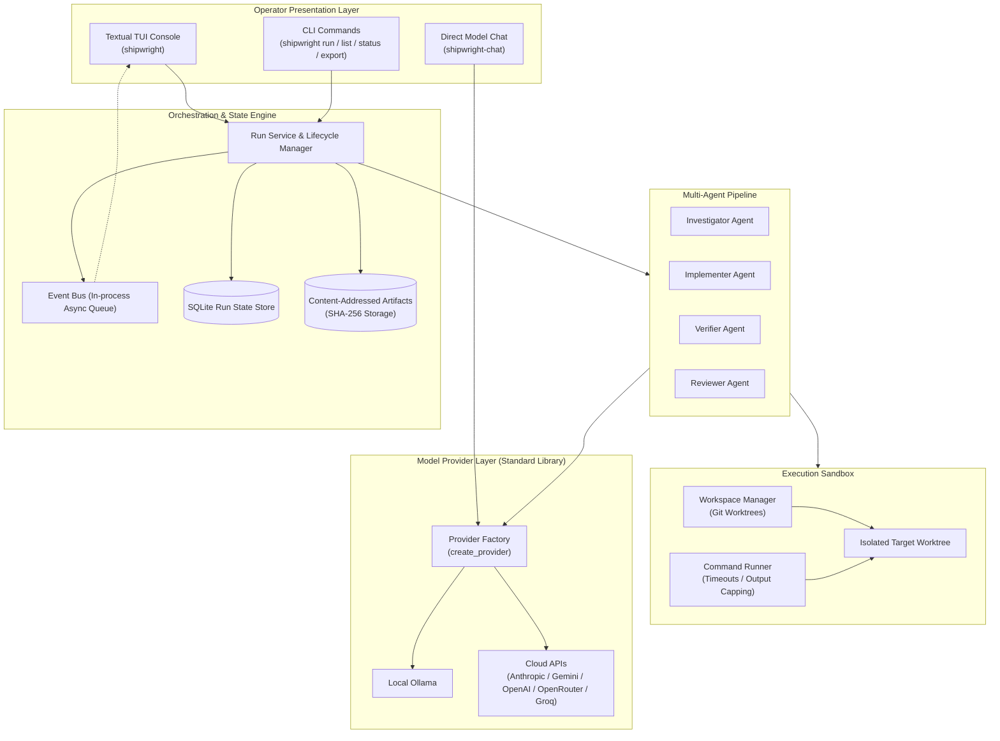
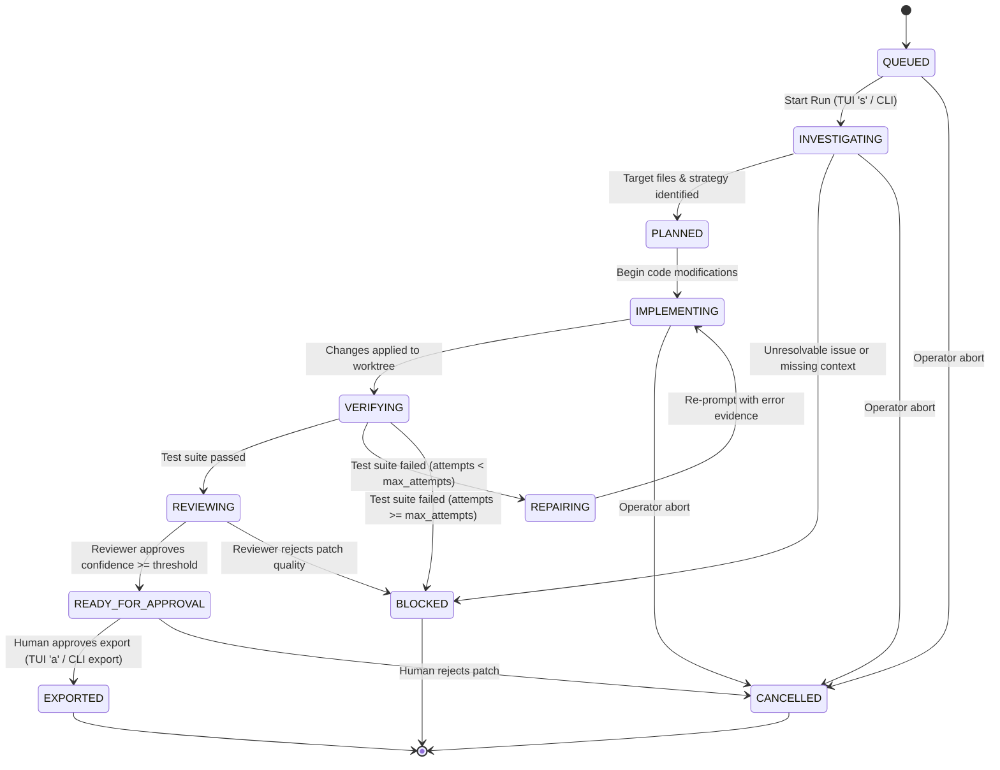
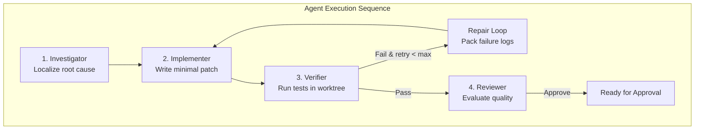

# Shipwright Architectural Specification & Execution Plan

Shipwright is a terminal-first autonomous issue-to-PR operator. It ingests reproducible issues, executes a bounded multi-agent coding workflow inside an isolated Git worktree, verifies code changes against real test suites, and prepares an inspectable patch bundle. Publishing a branch or pull request is strictly guarded by an explicit human approval gate.

---

## 1. Product Boundary & Scope

### In Scope (MVP)
- **Target Environments:** Python 3.14+ repositories managed with standard toolchains (`uv`, `pytest`, `unittest`).
- **Single-Issue Bounded Lifecycle:** One repository checkout and one issue per execution run.
- **Isolated Worktree Execution:** All code modifications, test executions, and repairs take place in ephemeral Git worktrees, preserving the user's primary working tree.
- **Four Specialized Agent Roles:**
  - `Investigator`: Localizes failure root causes, parses issue bodies, and identifies candidate target files.
  - `Implementer`: Formulates minimal code modifications and writes regression test cases.
  - `Verifier`: Executes repository test commands in the sandbox, captures logs, and reports pass/fail diagnostics.
  - `Reviewer`: Assesses the generated git diff, evaluates test logs, scores confidence, and recommends approval.
- **Bounded Self-Correction Loop:** Automatic repair attempts (`REPAIRING`) triggered on test failures up to a configurable attempt cap (`max_attempts`).
- **Interactive TUI Operator Console:** Real-time event streaming, queue status, agent telemetry, diff inspection, log viewer, and approval gate.
- **Headless CLI Command Suite:** Scriptable commands for running, listing, inspecting, exporting, and testing without launching the full TUI.
- **Zero-Dependency Provider Engine:** Pure Python standard library HTTP adapters supporting local Ollama and major cloud LLM providers.

### Explicitly Out of Scope
- Unattended automatic merges to production or default branches.
- Unbounded retry loops without hard exit conditions.
- Multi-tenant hosted services or remote cloud-managed execution daemons.
- Direct mutation of the user's primary Git checkout.

---

## 2. System Architecture

Shipwright separates the presentation layer (TUI and CLI) from the execution engine (Run Service, Agent Orchestrator, and Sandbox Manager).



### Component Breakdown
1. **Operator Presentation Layer:**
   - **Textual TUI (`shipwright`):** Terminal UI providing real-time visibility into active runs, agent actions, timeline logs, and diff artifacts.
   - **CLI Subcommands (`shipwright run`, `status`, `list`, `export`):** Scriptable, headless interface for CI/CD and terminal automation.
   - **Smoke Tester (`shipwright-chat`):** Instant verification of provider connectivity and model completions.
2. **Orchestration & State Engine:**
   - **Run Service:** Coordinates lifecycle state transitions, initializes worktrees, and dispatches agent tasks.
   - **Event Bus:** Emits timestamped lifecycle and diagnostic events to connected consumers (TUI, logs, webhooks).
   - **Persistence Store:** Stores run records, issue metadata, agent states, and review decisions in SQLite.
   - **Artifact Store:** Persists immutable diffs, stdout/stderr logs, plans, and export bundles, indexed by SHA-256.
3. **Multi-Agent Pipeline:**
   - Runs sequential and iterative agent loops with specialized system prompts and typed domain inputs.
4. **Execution Sandbox:**
   - Isolates mutations inside dedicated Git worktrees (`shipwright/run-<id>`).
   - Executes commands with deterministic timeouts, capped output buffers, and safe process termination.
5. **Provider Layer:**
   - Zero third-party HTTP dependencies; relies entirely on standard library `urllib.request`.
   - Normalizes message schemas, authorization headers, and response formats across all providers.

---

## 3. Run Lifecycle State Machine

Each run follows a deterministic finite state machine with bounded repair iterations.



### State Definitions
- `QUEUED`: Issue is ingested and awaiting operator or automated trigger.
- `INVESTIGATING`: Investigator agent localizes issue symptoms, relevant modules, and reproduction cases.
- `PLANNED`: Problem analysis complete; implementation approach formulated.
- `IMPLEMENTING`: Implementer agent applies targeted file edits in the dedicated worktree.
- `VERIFYING`: Verifier runs tests (`pytest`, `unittest`) in the worktree and captures execution evidence.
- `REPAIRING`: Verifier detected failure; repair context is prepared with failing logs for the Implementer.
- `REVIEWING`: Verifier tests succeeded; Reviewer agent evaluates diff quality, security, and cleanliness.
- `READY_FOR_APPROVAL`: All automated stages succeeded; paused waiting for explicit human review.
- `EXPORTED`: Human approved the patch; export bundle generated or pull request created.
- `BLOCKED`: Run halted due to exceeded retry caps, unresolvable test errors, or missing prerequisites.
- `CANCELLED`: Manually terminated by operator command.

---

## 4. CLI Command Specification

Shipwright provides a unified command-line interface supporting both interactive TUI usage and headless automation.

### Entrypoints
- `shipwright`: Launches the interactive Textual TUI operator console.
- `shipwright <subcommand>`: Executes headless subcommands.
- `shipwright-chat`: Dedicated direct-model chat utility for smoke testing.

```text
shipwright [OPTIONS] [SUBCOMMAND]
```

### Subcommands

#### 1. `shipwright` (default)
Launches the full interactive terminal operator console.
```bash
uv run --locked shipwright
```

#### 2. `shipwright run <issue>`
Runs the autonomous issue-to-PR pipeline for an issue without requiring the interactive TUI.
```bash
uv run --locked shipwright run 1842 --repo /path/to/repo --provider ollama --model qwen2.5-coder:7b
```
- **Arguments:**
  - `issue`: Issue number (e.g. `1842`), GitHub issue URL, or path to local issue markdown/text file.
- **Options:**
  - `--repo <path>`: Root directory of target repository (defaults to current directory).
  - `--provider <name>`: Model provider override (e.g. `ollama`, `openrouter`, `anthropic`, `openai`).
  - `--model <name>`: Model identifier override.
  - `--max-attempts <n>`: Maximum verification/repair loops (default: `3`).
  - `--test-cmd <cmd>`: Custom test command override (e.g. `pytest tests/unit`).
  - `--auto-approve`: Automatically approve export if reviewer passes (disabled by default).

#### 3. `shipwright status [run_id]`
Inspects the current state, active agent, test results, and recent timeline events.
```bash
uv run --locked shipwright status 1842
uv run --locked shipwright status 1842 --json
```
- **Arguments:**
  - `run_id`: Unique run identifier or issue number. If omitted, reports the most recent run.
- **Options:**
  - `--json`: Format output as machine-readable JSON.
  - `--watch`: Stream timeline events in real time until run reaches terminal state.

#### 4. `shipwright list`
Lists all tracked runs with status filters and metadata summaries.
```bash
uv run --locked shipwright list
uv run --locked shipwright list --state READY_FOR_APPROVAL
```
- **Options:**
  - `--state <state>`: Filter by `RunState` (e.g. `QUEUED`, `VERIFYING`, `READY_FOR_APPROVAL`, `EXPORTED`).
  - `--limit <n>`: Maximum number of runs to display (default: `20`).
  - `--json`: Output as structured JSON list.

#### 5. `shipwright export <run_id>`
Exports the generated patch, test evidence, plan, and reviewer summary as a standalone bundle.
```bash
uv run --locked shipwright export 1842 --output ./dist/patches/
uv run --locked shipwright export 1842 --format patch > fix-1842.patch
```
- **Arguments:**
  - `run_id`: Identifier of a run in `READY_FOR_APPROVAL` or `EXPORTED` state.
- **Options:**
  - `--output <path>`: Directory or file destination for exported bundle (default: `./artifacts/`).
  - `--format <bundle|patch>`: Output as comprehensive directory bundle or raw unified diff patch.
  - `--approve`: Transition run state from `READY_FOR_APPROVAL` to `EXPORTED`.

#### 6. `shipwright-chat [prompt]`
Utility for quick verification of provider configuration, API keys, and model latency.
```bash
uv run --locked shipwright-chat "Reply with exactly: SHIPWRIGHT_OK"
uv run --locked shipwright-chat --provider anthropic --model claude-3-5-sonnet-latest "Summarize test isolation."
```
- **Arguments:**
  - `prompt`: Input prompt text (defaults to `"Reply with exactly: SHIPWRIGHT_OK"`).
- **Options:**
  - `--provider <name>`: Temporary override of `SHIPWRIGHT_PROVIDER`.
  - `--model <name>`: Temporary override of `SHIPWRIGHT_MODEL`.

---

## 5. TUI Operator Console Specification

The Textual console provides a keyboard-first operator interface designed for low latency and zero mouse dependence.

### Screen Layout
```text
┌─ Header: Shipwright · Autonomous issue-to-PR operator ────────────────────────────────┐
│                                                                                       │
│ ┌─ RUN QUEUE (43%) ───────────────┐ ┌─ SELECTED RUN (57%) ──────────────────────────┐ │
│ │ #1842 Fix flaky retry test      │ │ #1842 Fix flaky retry test                    │ │
│ │       VERIFYING · 02:14         │ │ ┌───────────────┬───────────────┬───────────┐ │ │
│ │ #1839 Handle null config        │ │ │ STATE         │ AGENTS        │ TESTS     │ │ │
│ │       REVIEWING · 08:51         │ │ │ VERIFYING     │ 3 / 3         │ 42 passed │ │ │
│ │ #1828 Pin dependency            │ │ └───────────────┴───────────────┴───────────┘ │ │
│ │       READY_FOR_APPROVAL · 12:03│ │ TIMELINE                                      │ │
│ │                                 │ │ 12:14:03 investigator identified src/retry.py │ │
│ │                                 │ │ 12:14:19 implementer  patched backoff bound   │ │
│ │                                 │ │ 12:15:02 verifier     running pytest          │ │
│ │                                 │ │ ARTIFACTS                                     │ │
│ │                                 │ │ • git diff · 18 lines                         │ │
│ │                                 │ │ • pytest log · 42 passed                      │ │
│ └─────────────────────────────────┘ └───────────────────────────────────────────────┘ │
│                                                                                       │
├─ Footer: [s] Start  [a] Approve Export  [d] Diff  [l] Logs  [r] Refresh  [q] Quit ───┤
└───────────────────────────────────────────────────────────────────────────────────────┘
```

### Keyboard Shortcuts
| Key | Action | Description |
| :---: | :--- | :--- |
| `s` | **Start Run** | Dispatches agent pipeline for the currently highlighted run in `QUEUED` state. |
| `a` | **Approve Export** | Approves candidate changes for a run in `READY_FOR_APPROVAL`, transitioning to `EXPORTED`. |
| `d` | **Diff Viewer** | Opens modal overlay displaying the generated unified Git diff patch. |
| `l` | **Logs Viewer** | Opens modal overlay streaming real-time subprocess test logs and agent diagnostics. |
| `r` | **Refresh** | Reloads run queue, active metrics, and timeline state from persistence. |
| `q` | **Quit** | Exits the Textual application cleanly. |
| `j` / `↓` | **Next Run** | Moves selection cursor down in the run queue. |
| `k` / `↑` | **Previous Run** | Moves selection cursor up in the run queue. |
| `Enter` | **Select Run** | Focuses and loads complete details for the selected run. |

---

## 6. Multi-Agent Orchestration & Roles

Each agent operates with isolated responsibility, distinct system prompts, and structured input/output contracts.



### 1. Investigator Agent
- **Input:** Issue title, issue body, repository file listing, test configuration.
- **Task:** Locates relevant files, identifies reproduction cases, and formulates a surgical fix hypothesis.
- **Output:** Structured investigation plan artifact with targeted file paths and root cause analysis.

### 2. Implementer Agent
- **Input:** Investigation plan, target file contents, and (if repairing) previous test failure logs.
- **Task:** Produces minimal, idiomatic code modifications and accompanying regression tests.
- **Output:** Unified patch artifact applied directly to the isolated Git worktree.

### 3. Verifier Agent
- **Input:** Target repository worktree path, declared test command (`pytest`, `unittest`).
- **Task:** Spawns sandboxed subprocess, captures stdout/stderr, records exit status, and isolates failures.
- **Output:** Execution log artifact, test pass/fail metrics, and failure diagnostics.

### 4. Reviewer Agent
- **Input:** Cumulative git diff, test verification logs, original issue requirements.
- **Task:** Evaluates patch correctness, backward compatibility, style adherence, and potential regression risks.
- **Output:** Review assessment with `passed: bool`, `confidence: float`, and prioritized findings.

---

## 7. Isolated Execution Sandbox & Safety

Shipwright adheres to strict defense-in-depth safety principles:

1. **Git Worktree Isolation:**
   - Changes are never executed on the user's primary working tree or current branch.
   - For every run, Shipwright creates an isolated worktree under `.shipwright/worktrees/run-<id>` backed by a dedicated branch (`shipwright/run-<id>`).
   - On completion or cancellation, worktrees are pruned cleanly via `git worktree remove --force`.
2. **Subprocess Boundary & Sandboxing:**
   - Subprocesses are spawned with explicit working directory constraints restricted to the worktree path.
   - Command timeouts prevent runaway test suites or infinite loops (default: 120s per test execution).
   - Standard output and error buffers are capped (default: 1 MB) to prevent out-of-memory crashes.
   - Process groups (`setsid`) ensure that all child and grandchild processes are terminated upon timeout or cancellation.
3. **Bounded Repair Loops:**
   - Verification failures re-enter the `IMPLEMENTING` stage via `REPAIRING` with error log feedback.
   - Iterations are strictly capped by `max_attempts` (default: 3). When exceeded, the run transitions to `BLOCKED`.
4. **Human-in-the-Loop Approval:**
   - Automated agents cannot publish Git branches, push to remotes, or open GitHub Pull Requests.
   - Reaching `READY_FOR_APPROVAL` halts execution until an operator explicitly presses `a` in the TUI or executes `shipwright export <id> --approve`.

---

## 8. Data Models & Storage Architecture

### Domain Models (`shipwright.models`)
- `Issue`: `number`, `title`, `body`, `source`, `labels`, `url`.
- `Repository`: `root`, `default_branch`, `test_cmd`.
- `Run`: `number`, `title`, `state`, `elapsed`, `agents`, `tests`, `events`, `artifacts`, `issue`, `repo_path`, `worktree_path`, `branch`, `attempt`, `max_attempts`, `review`, `error`.
- `TimelineEvent`: `timestamp`, `actor`, `message`.
- `Artifact`: `name`, `path`, `content`, `checksum`, `size`, `artifact_type`.
- `Review`: `passed`, `confidence`, `summary`, `findings`.

### SQLite Schema (`.shipwright/state.db`)
```sql
CREATE TABLE IF NOT EXISTS runs (
    number INTEGER PRIMARY KEY,
    title TEXT NOT NULL,
    state TEXT NOT NULL,
    repo_path TEXT NOT NULL,
    worktree_path TEXT,
    branch TEXT,
    attempt INTEGER DEFAULT 0,
    max_attempts INTEGER DEFAULT 3,
    created_at TIMESTAMP DEFAULT CURRENT_TIMESTAMP,
    updated_at TIMESTAMP DEFAULT CURRENT_TIMESTAMP
);

CREATE TABLE IF NOT EXISTS timeline_events (
    id INTEGER PRIMARY KEY AUTOINCREMENT,
    run_number INTEGER NOT NULL REFERENCES runs(number),
    timestamp TEXT NOT NULL,
    actor TEXT NOT NULL,
    message TEXT NOT NULL
);

CREATE TABLE IF NOT EXISTS artifacts (
    id INTEGER PRIMARY KEY AUTOINCREMENT,
    run_number INTEGER NOT NULL REFERENCES runs(number),
    name TEXT NOT NULL,
    path TEXT NOT NULL,
    checksum TEXT NOT NULL,
    size INTEGER NOT NULL,
    artifact_type TEXT NOT NULL,
    created_at TIMESTAMP DEFAULT CURRENT_TIMESTAMP
);
```

---

## 9. Provider Layer Architecture

Shipwright implements a standardized, zero-third-party-dependency model adapter layer in `shipwright.providers`.

### Supported Providers
- **Local Ollama:** Default configuration. Fully offline, no credentials required.
- **Cloud LLMs:**
  - Anthropic (`claude-3-5-sonnet-latest`, `claude-3-5-haiku-latest`)
  - Google Gemini (`gemini-2.5-flash`, `gemini-1.5-pro`)
  - OpenAI (`gpt-4o-mini`, `gpt-4o`)
  - OpenAI-Compatible Presets: OpenRouter, Groq, Together, Mistral, DeepSeek, Fireworks, Cerebras, NVIDIA NIM, xAI, Perplexity.

### Normalization Pipeline
1. Standardized chat message structure: `[{"role": "user"|"assistant"|"system", "content": "..."}]`.
2. URL validation and HTTP header injection (`Authorization`, `Content-Type`, `User-Agent`).
3. Payload translation into provider-specific schemas (e.g. Anthropic's top-level `system` separation, Gemini's `contents.parts`).
4. HTTP request dispatch via `urllib.request.urlopen` with socket timeouts.
5. Error mapping into typed `ProviderError` with HTTP status codes and diagnostic root causes.

---

## 10. Runtime & Environment Specification

- **Python Runtime:** Python 3.14+ (pinned to 3.14.7 in [`.python-version`](../.python-version)).
- **Package & Virtual Environment Manager:** [uv](https://docs.astral.sh/uv/) for high-speed, deterministic dependency locking.
- **Dependency Manifest:** Locked dependencies in [`uv.lock`](../uv.lock) and project metadata in [`pyproject.toml`](../pyproject.toml).
- **Core Dependencies:** `textual>=0.80,<1` for terminal user interface.

---

## 11. Delivery Milestones

```text
Milestone 1: Domain Models & Provider Foundation [COMPLETED]
├── Models: Run, Issue, Repository, TimelineEvent, Artifact, Review
├── Zero-dependency Provider Engine (Ollama, Anthropic, Gemini, OpenAI, Presets)
└── Deterministic Provider Test Suite with Local Mock Servers

Milestone 2: Terminal UI & Navigation [COMPLETED]
├── Textual TUI Application Shell & Dark Theme
├── Real-time Run Queue & Detail Inspection Panels
└── Keyboard Bindings (q=Quit, r=Refresh, j/k Navigation)

Milestone 3: Complete TUI Controls & Subprocess Sandbox [IN PROGRESS]
├── Bindings: s=Start Run, a=Approve Export, d=Diff Viewer, l=Logs Viewer
├── Git Worktree Manager (disposable sandbox creation/cleanup)
└── Subprocess Command Runner with timeouts and output capture

Milestone 4: Multi-Agent Orchestration Loop [NEXT]
├── Investigator, Implementer, Verifier, Reviewer Agent Implementations
├── Bounded Self-Correction Repair Loop
└── SQLite Run State Store & Event Bus Persistence

Milestone 5: Headless CLI Command Suite [NEXT]
├── shipwright run, shipwright status, shipwright list, shipwright export
└── JSON streaming output for automated CI pipelines

Milestone 6: GitHub Integration & Delivery [FUTURE]
├── Remote GitHub issue fetcher via gh CLI / token
├── Branch publication and draft PR preparation
└── Verification check summaries posted to PR comments
```
